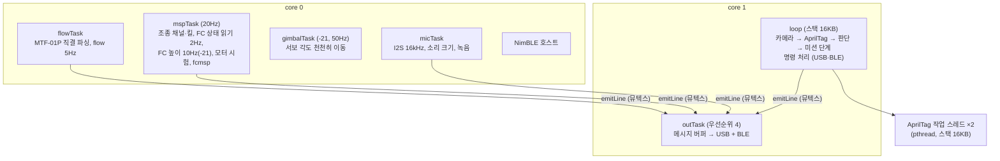

# 04. 펌웨어 (`tag-board-fw/`)

- 플랫폼: PlatformIO `espressif32@6.9.0` (arduino-esp32 2.0.17), 보드 `seeed_xiao_esp32s3`, 최적화 `-O2`
- 라이브러리:
  - AprilTag: [raspiduino/apriltag-esp32](https://github.com/raspiduino/apriltag-esp32) v3.4.0 (BSD-2)를 `lib/apriltag`에 포함
  - BLE: `h2zero/NimBLE-Arduino@1.4.3` (2.x는 이 코어와 맞지 않음)
- **보드에서 동작 중인 빌드: `TAGVISION-20261010-20`** (2026-10-10 BLE로 확인)
- 저장소 소스는 `-21`(FC 높이 사용, 카메라 팬·틸트)까지 작성돼 있다. **아직 빌드·PC 시험·업로드 전이다.**

## 구조



- 출력은 모두 `emitLine()` → FreeRTOS 메시지 버퍼 → `outTask` 한 곳에서 USB와 BLE로 내보낸다.
  - 메시지 버퍼는 쓰는 쪽이 하나여야 안전해서 뮤텍스로 묶는다.
  - USB 쓰기를 core 1 한 곳에서만 하는 이유는 [02](02-xiao-esp32s3-sense.md)에 있다.
- 공유 상태(높이, 판단, MSP 통계, FC 상태, 모터 시험, 서보 각도)는 `portMUX` 임계 구역으로 보호한다.

## 소스 파일

| 파일 | 역할 |
|---|---|
| `src/main.cpp` | 작업 흐름 전체: 카메라·AprilTag, 판단·미션, MSP, 명령, 출력 |
| `src/config.h` | 핀, 주기, 제어 이득, 킬 채널, 미션 고도, 서보 보정값, 태그 표, 음성 명령 표 등 모든 설정 |
| `src/mtf01p.h` | MTF-01P 파서 (Micolink + MSP v2 자동 구분) |
| `src/msp.h` | MSP **v1·v2** 프레임 생성·해석 (하드웨어 무관, PC 테스트 대상) |
| `src/gimbal_geom.h` (`-21`) | 팬·틸트 각도로 광선을 돌려 기체 기준 위치를 구하는 계산 (하드웨어 무관) |
| `src/gimbal.h/.cpp` (`-21`) | 서보 PWM(LEDC 타이머 1), 천천히 움직이기, 정지 판정 |
| `src/ble_link.h/.cpp` | BLE Nordic UART Service |
| `src/mic.h/.cpp`, `src/adpcm.h` | INMP441 입력, 녹음 ADPCM 압축 |
| `lib/apriltag/` | AprilTag 라이브러리. **tag36h11 코드를 원본 587개로 복원**했다. 이 포트는 메모리 때문에 35개(ID 0~34)로 줄여 놓았었다 |
| `test/` | PC 테스트: MSP 프레임(v1·v2), MTF 파서, ADPCM 왕복. 팬·틸트 계산 테스트는 `-21`에서 추가 예정 |

## 빌드·업로드·복구

```bash
cd tag-board-fw
pio run -t upload --upload-port /dev/cu.usbmodem2101

# 원래 펌웨어(RIDER-SERIAL-20260924-06)로 되돌리기 (D4D 폴더에서)
python3 ~/.platformio/packages/tool-esptoolpy/esptool.py --port /dev/cu.usbmodem2101 \
  write_flash 0 firmware-backup/RIDER-SERIAL-20260924-06_full8MB.bin
```

- 백업 SHA256: `0455ced91d45eef0207160dd5ec3f9e25a8326daf4315f4a5a34de6e73d5e443`
- 업로드에는 USB 연결이 필요하다. 블루투스 OTA 업데이트는 없다.
- 업로드 전에 다른 프로그램이 포트를 잡고 있지 않은지 확인한다(`lsof /dev/cu.usbmodem2101`). 10-10에는 다른 프로젝트의 `device/bridge.py`가 포트를 잡아 업로드가 실패했다.
- USB가 멈춰 업로드가 안 되면 USB-C를 뽑았다 다시 꽂는다([02](02-xiao-esp32s3-sense.md)).

## 주요 설정값 (`config.h`)

| 항목 | 값 |
|---|---|
| 카메라 | VGA 640×480 회색조, 수평 화각 55° (fx 약 615px) |
| AprilTag | tag36h11, 오류 정정 1비트, 작업 스레드 2개, margin 30 미만 버림 |
| decimate | 자동 (시작 3.0, 2.0/3.0/4.0 중 선택) |
| 정렬 판정 | 착륙 지점이 기체 바로 아래에서 3cm 이내 |
| 축 매핑 | `CAM_ROTATE_DEG 0`, `AXES_VERIFIED false` (실측 전) |
| MSP 송신 (`-25`~) | **50Hz, CH6와 무관하게 상시 송신** (`MSP_SEND_HZ 50`, `MSP_TX_ALWAYS true`). 8채널, 슬롯 순서는 FC `rcmap`(기본 AETR) |
| FC 질의 예산 (`-26`) | INAV는 MSP 포트당 10ms에 명령 **하나**만 처리(100/s). SET_RAW_RC 50 + `MSP_RC` 16.7(`MSP_POLL_EVERY 3`) + 광류 10 + 높이 10 + 자세 2 + 상태 2 + 배터리 1 + 모터 1 + 설정 1 ≈ 94/s. 늘리기 전에 `config.h` 주석의 예산을 먼저 고친다 |
| **스로틀 슬롯** (`-24`~) | 항상 **1000** (`MSP_THROTTLE_SAFE_US`). 보드에는 스로틀 계산 경로가 없다. FC 마스크에 스로틀 비트(8)가 있으면 제어기가 `fault:"mask"` |
| **킬 채널** | `MSP_CH_KILL 6` = ch7. 평소 1000, `kill`이면 2000 (FC 마스크에 64가 있어야 반영) |
| 제어권 (`-23`~) | `MSP_RC`의 ch6(인덱스 5)가 900~1700이면 AUTO, 그 밖·응답 없음(250ms)이면 MANUAL. 수동이면 제어기 출력 0 |
| FC 상태 읽기 | 상태 2Hz, 배터리·모터 출력 1Hz (`FC_POLL_PERIOD 50`) |
| FC 높이 읽기 (`-21`) | `MSP_SONAR_ALTITUDE` 10Hz (`FC_ALT_POLL_EVERY 5`). MTF-01P가 보드에 직접 연결돼 있지 않을 때 사용 |
| FC 설정 읽기 (`-25`) | 2초마다 `MSP_RX_MAP`(rcmap)과 `MSP2_COMMON_SETTING "msp_override_channels"`. 못 읽으면 `mask_unknown`으로 출력 차단 |
| 접근 제어 (`-23`~, `approach.h`) | 목표속도 ≤10cm/s(`max_speed`), 25cm 안에서 감속, 5cm 안 정지, 가속 10cm/s², 광류 속도 P 제어, 명령 상한 ±cmd_max·변화율 cmd_slew. deadband 안·도착 뒤 중립, 태그 유실 즉시 중립, 실측 12cm/s 넘으면 제동. 부팅 모드 `shadow`(계산·로그만) |
| 지상 시험 입력 (`-27`) | `approach bench`일 때만: 높이는 거리센서가 무효면 태그 크기 거리, 속도는 카메라 위치 미분(지수평활 0.5, 신선도 `tag_stale_ms`). 비행 기본값은 거리센서·광류 |
| MTF vz 경고 (`-25`) | FC 높이로 수직속도 추정, \|vz\|>10cm/s면 `warn` 1초 1회. 스로틀은 건드리지 않음 |
| 레거시 제어 이득 (`approach legacy`) | 롤·피치 4µs/cm, 최대 ±80µs |
| 스로틀 제어 | `CTRL_THROTTLE_ENABLED false` (시뮬레이터에만 허용) |
| 미션 | 50cm → 3초 유지 → 100cm, 도달 판정 ±5cm |
| 모터 시험 한도 | 15%(1150), 5초 |
| 카메라 서보 (`-21`) | D8 팬·D9 틸트, 50Hz, 14비트, 0° = 1500µs, 10µs/°, 팬 ±90°·틸트 −30~90°, 최대 120°/s, 정지 판정 250ms ([13](13-camera-pan-tilt.md)) |
| 시뮬레이션 | `simh`가 2초간 없으면 실제 센서로 복귀 |
| 마이크 | 16kHz, 이득 ×16, 녹음 최대 3초 |
| 메모리 | 카메라·BLE 초기화 뒤 `heap_caps_malloc_extmem_enable(32)`: 32바이트 이상 할당은 PSRAM으로 |

## 명령 (USB·BLE 공통, 한 줄 + 줄바꿈)

| 명령 | 동작 |
|---|---|
| `info` | 현재 상태·설정 출력 |
| `snap` | 카메라 화면 JPEG (base64를 1000자씩 나눈 줄, `SNAP_BEGIN` … `SNAP_END`) |
| `tags` | 태그 표 출력 |
| `size <id> <mm>` | 태그 한 변 길이 설정 (NVS 저장) |
| `land <id> <x> <y>` | 태그 중심 → 착륙 지점 오프셋(mm), 인쇄물 기준 오른쪽 +x, 위쪽 +y (NVS 저장) |
| `reset <id>` | 그 태그의 NVS 설정 삭제 |
| `dec auto` / `dec <1.0~4.0>` | decimate 자동 / 수동 고정 (카메라가 없으면 거부) |
| `msp on` / `msp off` | FC로 MSP 송신 켜기/끄기 (끄면 INAV가 약 0.7~0.9초 안에 조종기로 복귀) |
| `mission reset` | 미션 단계를 '정렬'로 |
| `simh <cm>` / `sim off` | 시뮬레이션 고도 / 즉시 종료 |
| `mtfraw` | MTF-01P에서 들어오는 다음 64바이트를 hex로 |
| `motortest <1~4\|all> <퍼센트> <초>` | 아밍 전 모터 시험. FC 응답 없으면 거부, 15%·5초 상한 |
| `motorstop` | 모터 시험 즉시 정지 |
| **`kill`** / **`kill off`** | 킬 채널(ch7)을 2000 / 1000으로. `msp off`여도 킬 채널은 계속 보냄 ([07](07-fc-msp-integration.md)) |
| `fcmsp <명령번호> [hex]` | FC에 MSP 질의 하나를 보내고 응답을 hex로 보여줌 (진단용). 255 초과면 MSP v2. **200(SET_RAW_RC)·214(SET_MOTOR)·68(REBOOT)은 거부** |
| `cam` … (`-21`) | `cam` 상태 / `cam <팬°> <틸트°>` / `cam down` / `cam front` / `cam off` / `cam us <팬µs> <틸트µs>`(보정) |
| `rec <초>` | 0.2~3초 녹음 → `MIC_BEGIN` … `MIC_END` |
| `voicecmd <키워드>` | 음성 명령 표의 명령 실행 (`motortest`·`voicecmd`·`fcmsp`는 거부) |
| `approach` … (`-23`~) | `approach` 상태 / `approach on\|shadow\|legacy\|off` 모드 / `approach reset` / `approach params` / `approach set <이름> <값>`. 재부팅하면 `shadow`로. `on`은 FC 마스크가 정상(스로틀 비트 없음)일 때만 출력 |
| `exp` … (`-31`) | `exp` 상태 / `exp auto [ae -2~2]` / `exp fast`(노출 20·게인 8) / `exp <노출 0~1200> [게인 0~30]` |
| `tagcal` … (`-33`) | `tagcal` 상태(설정·추정·유지·표본 수·퍼짐·쓰는 크기) / `tagcal on\|off\|reset` / `tagcal save <id>`(수렴값을 NVS에 저장) |
| `approach bench` / `approach flight` (`-27`) | 지상 시험 입력(높이 = 태그 크기로 잰 거리, 속도 = 카메라 상대 속도) + 출력 `on` / 비행 입력(거리센서·FC 광류)으로 복귀. 재부팅하면 비행 입력. 파라미터 `vel_src`(0 광류·1 카메라), `height_src`(0 거리센서·1 태그 거리 대체), `tag_vel_alpha`(카메라 속도 평활, 0.5) |

## 출력 메시지 (한 줄에 JSON 하나)

| type | 주기 | 주요 필드 |
|---|---|---|
| `boot` / `info` | 부팅 / 요청 시 | build, camera_sensor, frame, decimate, dec_mode, msp, fc_tx/rx, sim, ble, ble_connected, ble_mtu, ble_dropped, ble_buf, ram_min, ram_largest, heap_free, psram_free, dropped_lines, gimbal·height_src(`-21`) |
| `tags` | 부팅 / 요청 시 | id, size_mm, land_x_mm, land_y_mm, meaning |
| `flow` | 5Hz | connected, height_cm, forward/right/up_cm_s, raw_x/y, quality, flow_status, tof_status, packets, errors, proto(micolink/msp), sim, height_src(`-21`: mtf/fc/sim). FC 출처면 속도는 null |
| `tag` | 태그마다 | id, registered, meaning, side_px, rot_deg, tag_size_mm, land_px, img_right/up_cm, dist_est_cm, margin. `-33`~: size_src(auto/config), size_cfg_mm, cal_n, cal_spread |
| `target` | 미션 태그가 보이는 프레임마다 | id, decision(OVER_TARGET/MOVE, `-21`: GIMBAL_MOVING/NO_GEOMETRY), move_ko, next_ko, phase, body_right/fwd_cm, offset_cm, height_cm, decimate, candidates. `-21`: height_src, gimbal{pan,tilt,settled}, range_src(tag_size/height), ray_down, control_use |
| `vision` | 2Hz | fps, detect_ms, ids, target_id, decimate_used/next, dec_mode, dec_reason, phase, gimbal·height_src(`-21`) |
| `msp` | 1Hz | enabled, fc_link, sent, acks, rc_replies, errors, out(보낸 값, rcmap 슬롯 순서), fc_rc(FC가 쓰는 값, 논리 순서: 롤·피치·요·스로틀·AUX), phase, kill. `-23`~: authority(auto/manual), authority_fresh, ch5, ch6, rc_throttle, rc_tx. `-25`~: tx_hz, tx_always, rcmap, rcmap_src(fc/default), fc_mask, mask_ok, mask_recommended, thr_slot, thr_slot_us, base_rpy(핸드오버 기준점), pilot_rpy, pilot_valid, auto_since_ms, vz_cm_s, vz_warn, vz_warn_count. `-26`: **ack_hz**(FC가 1초에 ack한 SET_RAW_RC 수, 정상이면 ≈tx_hz), rc_hz |
| `approach` (`-23`~) | 5Hz | mode, state(IDLE/APPROACH/ARRIVING/ARRIVED/HOLD/FAULT), fault, dist_cm, err_right/fwd_cm, target_speed, v_target, v_flow, v_flow_valid, flow_q, roll_us, pitch_us, tag, authority, ch6, height_cm, height_valid, att, arrive_held_ms. `-25`~: neutral, overspeed, vz_cm_s, vz_warn, mask_ok, out_rpy, thr_slot_us, rc_tx |. `-27`~: vel_src(flow/tag), h_src(rangefinder/tag/none). `-30`~: out(tilt/us), accel, tilt(°), expo, v_of(광류 교차 확인). `-34`~: fc_rp(FC가 받은 롤·피치), fc_rp_age_ms
| `approach_params` / `approach_mode` | 요청 시 | 파라미터 전부 / mode, fc_mask, warning |
| `authority` (`-25`~) | CH6 전환 시 | to(auto/manual), ch6, t, frame_age_ms(마지막 프레임 뒤 경과), tx_hz, out_rpy, thr_slot_us, pilot_rpy, pilot_valid, fc_rc, approach |
| `warn` (`-25`~) | 1초 1회 | code:"vz", vz_cm_s, limit_cm_s, height_cm, height_src, throttle_action:"none" |
| **`fc`** | 1Hz | status, armed, arming_flags(hex), blockers(아밍 차단 사유 이름), battery, vbat, cells, amps, motor[4], motor_ok, kill |
| `kill` | 명령 시 | state(on/off) |
| `fcmsp` | 질의 응답 | cmd, ok, error, size, hex (1초 안에 응답이 없으면 ok:false) |
| `gimbal` (`-21`) | `cam` 명령 시 | mode(angle/raw_us/off), pan, tilt, target_pan/tilt, known, settled, pan_us, tilt_us |
| `rc` | 시뮬레이션 중 20Hz | ch(롤·피치·스로틀·요), seen, centered, phase, sim_h |
| `motortest` | 시험 시 | state(running/stopping/stopped), motors, value, fc_acks |
| `mic` | 1Hz | ok, rms_db, peak_db, slot, ch_db, recording |
| `voice` | 실행 시 | keyword, ko, commands |
| `mtf_raw` | 요청 시 | hex |
| `cmd_error` / `help` | — | reason / commands |

## 버전 이력

### 2026-10-03

| 빌드 | 바뀐 점 |
|---|---|
| `-01` | 첫 버전: 카메라 + AprilTag + MTF-01P, JSON 출력, 스냅샷. USB 출력이 잘리는 문제를 core 1 출력 태스크로 해결 |
| `-02` | 패널 ID 10 등록, 화각 55° 보정, decimate 3.0 |
| `-03` | 태그별 크기와 착륙 지점 오프셋(중첩 태그), decimate 자동 전환, `target` 메시지 |
| `-04` | FC로 MSP 송신(UART2, D0·D1), 미션 단계, `msp on/off`, 메시지 버퍼 다중 작성자 버그 수정 |
| `-05` | 시뮬레이션 모드 (`simh`, `rc`) |
| `-06` | MTF-01P Micolink·MSP 자동 구분, 카메라 없이도 명령 처리, `mtfraw` |
| `-07` | 블루투스(BLE) |
| `-08`~`-16` | BLE 안정화: USB 대기 정책, 전송 버퍼 24개와 예비분, 알림 간격 4ms, 연결 직후 파라미터 요청 제거(컨트롤러 assert), 검출 메모리를 PSRAM으로(내부 RAM 고갈) |
| `-17` | `motortest`/`motorstop`, 부팅 시 정지 신호 |
| `-18` | INMP441 마이크, `rec`, `voicecmd` (빌드만, 업로드는 `-19`에 포함) |

### 2026-10-10

| 빌드 | 바뀐 점 |
|---|---|
| `-19` | MSP v2 송수신. FC 상태 읽기(`MSP2_INAV_STATUS`의 아밍 플래그 32비트, `MSP2_INAV_ANALOG` 전압·전류·셀 수, `MSP_MOTOR`)와 `fc` 1Hz 메시지. `kill`(당시 ch8), `fcmsp` 진단 질의. 음성 명령에서 `fcmsp` 차단 |
| `-20` | 킬 채널을 ch8 → **ch7**로. 새 FC 모드 배치(ch5 ARM, ch6 OVERRIDE, ch8 ANGLE)에 맞춤 |
| `-21` | MTF-01P가 FC로 옮겨진 구성 대응: FC 거리센서 높이(`MSP_SONAR_ALTITUDE`) 10Hz 읽기, 높이 출처 표시. 카메라 팬·틸트 서보(D8·D9), 각도를 반영한 위치 계산, 카메라가 움직이는 동안 판단 보류, `cam` 명령, 음성 키워드 `cam_down`·`cam_front` |
| `-23` | **접근 제어기** `approach.h`(AprilTag 저속 접근: 목표속도 ≤10cm/s, 감속·정지 반경, 가속 제한, 광류 속도 P, 안전 중지), 모드 `off/shadow/on/legacy`, `approach` 명령·JSON. **제어권** `rc_authority.h`(MSP_RC ch6로 AUTO/MANUAL 판정, 수동이면 출력 0). FC 광류(`MSP2_INAV_OPTICAL_FLOW`)·자세(`MSP_ATTITUDE`) 읽기. 호스트 테스트(`test/`) 추가 |
| `-24` | SET_RAW_RC **스로틀 슬롯 1000 고정** — CH6 AUTO 전환 시 FC 스로틀이 1500으로 뛴다는 엔지니어 보고 대응(마스크에 스로틀 비트가 있을 때 1500이 들어가던 문제) |
| `-25` | 엔지니어 요청 "수동 스로틀 유지형 수평 추적 시험": SET_RAW_RC **50Hz 상시 송신**(CH6 무관), 수동 중 조종기 스틱 추적 → AUTO 진입 시 **무충격 핸드오버**(기준점 고정 후 `handover_slew`로 1500 수렴), FC `rcmap`·`msp_override_channels` 읽어 스로틀 슬롯·마스크 검증(`mask`/`mask_unknown` fault), MTF vz 경고(기록만), deadband·태그 유실 중립, 과속 제동, `authority` 전환 이벤트. 상세: [`docs/2026-10-10-manual-throttle-tracking-test.md`](2026-10-10-manual-throttle-tracking-test.md) |
| `-26` | **FC MSP 처리 한도 대응**: INAV는 포트당 초당 100명령만 처리하는데 -25는 152개를 보내 절반이 버려졌음(ack 55%). 질의 예산을 94/s로 조정, `ack_hz`/`rc_hz` 추가, `tag_monitor`에 "FC수신 NNHz" 표시 |
| `-27` | **지상 시험 모드** `approach bench`/`flight`: 기체가 서 있어도 손으로 태그를 움직여 접근 제어를 시험(높이 = 태그 거리, 속도 = 카메라 상대 속도). `approach` JSON에 `vel_src`·`h_src`. 호스트 테스트 3개 추가. 상세: [지상 시험 보고서](2026-10-10-bench-approach-inav-test.md) |
| `-28` | `mspTask` 스택 6KB → **10KB**(측정 사용량 약 5.6KB), `info`에 `stack_free{msp,loop}` |
| `-29` | 시험용 종이 태그 **ID 1을 미션 목표로 등록**(200mm 가정, `size 1 <mm>`로 보정) |
| `-30` | **기울기 출력**(`out_tilt 1`): 가속도 `1.5 × 속도 오차`(상한 50cm/s²) → 기울기 → FC `rc_expo`·`deadband`를 읽어 INAV 곡선 역변환 → µs(상한 200, 400µs/s). 피드포워드 0. 정지 시 명령 ±16~24 → ±49µs. 상세: [비행 준비 보고서](2026-10-10-tilt-output-tagcal-flight-prep.md) |
| `-31` | 카메라 노출 명령 `exp` (`exp fast` = 노출 20·게인 8, 흐림 감소) |
| `-32` | `-30` 회귀 수정: 마스크 질의를 5번 중 4번으로, 마스크 유효 10초 (`mask_unknown` 고장 해소) |
| `-33` | **태그 크기 자동 보정** `tag_size_cal.h`·`tagcal` (거리센서 높이 × 화면 한 변 / fx). 높이 상한 기본 300cm. `info`에 `reset`(재부팅 원인)·`stack_free` |
| `-34` | 크기 보정은 **마지막 수렴값 유지**(퍼짐이 잠깐 커져도 설정값으로 안 돌아감). `approach` 줄에 `fc_rp`·`fc_rp_age_ms`(FC가 받은 롤·피치, 5Hz) — **현재 보드에 올라간 버전** |
