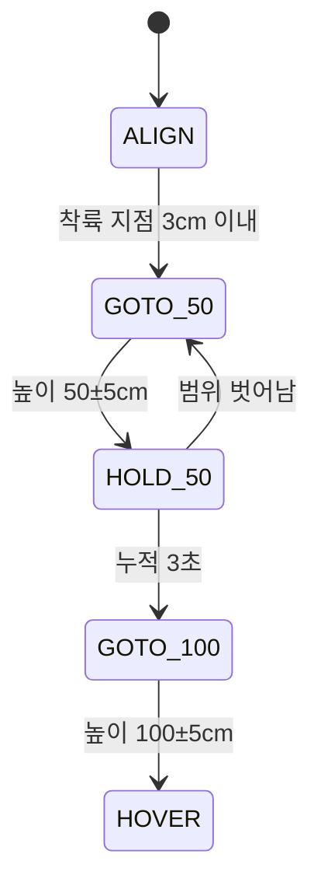

# 07. FC 연동 (MSP)

FC 설정 원본은 `fc-info/`에 있다. `diff_all_20261010.txt`는 10-10 변경 전 백업이고, `diff_all.txt`는 10-03 백업이다. [FC 정보 정리 문서](https://claude.ai/code/artifact/1369af2b-fbe6-4b09-942e-8c66aa56f68b)는 10-03 기준이므로 최신 값은 이 문서를 따른다.

## FC 요약 (2026-10-10)

| 항목 | 값 |
|---|---|
| 보드 · 펌웨어 | MicoAir H743 V2 (STM32H743 480MHz), INAV 9.1.0, 타깃 MICOAIR743V2 |
| 센서 | BMI088 · SPL06 · QMC5883 정상. **RANGEFINDER(MSP)·OPFLOW(MSP) 정상** (MTF-01P, UART4). GPS 없음 |
| SD 카드 | 인식됨 (3.9GB, Filesystem Ready). 10-03에는 실패했었음 |
| 수신기 | iBUS → UART6, Channel Map AETR. FS-i6 6채널이라 ch7·ch8은 항상 1500 |
| 모터 | 쿼드 X, DSHOT300, 공회전 3%, AIRMODE(THROTTLE_THRESHOLD), **`motorstop_on_low = OFF`(10-10 변경)** |
| failsafe | DROP (모터 정지) — 킬 기능이 이것을 쓴다 |
| 전압 | `vbat_scale` 2112, 셀 경고 3.50V · 최소 3.30V · 최대 4.20V. 전류 `current_meter_scale` 402 |

### 모드 배정

| 채널 | 모드 | 범위 | 비고 |
|---|---|---|---|
| ch5 (AUX1) | ARM | 1700~2100 | 조종기 스위치 |
| ch6 (AUX2) | **MSP RC OVERRIDE** | 900~1700 | 스위치가 1000·1500 쪽이면 보드 조종 켜짐, 2000이면 꺼짐 |
| ch7 (AUX3) | **FAILSAFE** | 1700~2100 | **10-10 추가. 킬 기능.** 조종기는 1500(꺼짐), 보드가 덮어씀 |
| ch8 (AUX4) | ANGLE | 900~2100 | 항상 켜짐 |

PREARM은 10-10에 사용자가 지웠다.

### 포트

| UART | 기능 |
|---|---|
| USB | MSP (Configurator·CLI) |
| **UART4** | **MSP — MTF-01P** |
| **UART5** | **MSP — 태그인식 보드** |
| UART6 | iBUS 수신기 |
| UART1·2·3·7·8 | 꺼짐 |

## 2026-10-10 설정 변경 이력

| 시각 | 누가 · 방법 | 변경 |
|---|---|---|
| 10:51 이전 | 사용자 · Configurator | 모드(ARM ch5, OVERRIDE ch6, ANGLE ch8, PREARM 삭제), UART4·UART5 MSP, 거리센서·옵티컬플로우 MSP. 백업 `fc-info/diff_all_20261010.txt` |
| 11:20 전후 | Claude · FC USB CLI | `aux 3 27 2 1700 2100`, `set msp_override_channels = 64`, `save` (재부팅으로 CLI 차단도 풀림) |
| 11:36 | Claude · 보드 경유 MSP | `motorstop_on_low = OFF` (`MSP2_COMMON_SET_SETTING` 0x1004) → `MSP_EEPROM_WRITE` 250. 첫 저장은 FC가 아밍돼 있어 거부됐고, 디스아밍 직후 저장 |
| 19:00 전후 | 엔지니어 · CLI | `set msp_override_channels = 7`(롤·피치·요, 스로틀 없음). 보드가 `fcmsp 0x1003`으로 읽은 원문 `07 00 00 00`, `rcmap`(64) 원문 `00 01 03 02` = AETR. **마스크 7이면 보드 `kill`(ch7, 비트 64)은 FC에 반영되지 않는다** → 보드 킬까지 쓰려면 71 |
| 21:40 전후 | Claude · 보드 경유 MSP (사용자 승인) | 보드가 읽은 값이 `rangefinder_hardware = NONE`, `opflow_hardware = NONE`(바뀐 경위 불명, 오전 백업은 `MSP`) → `0x1004`로 각각 3(MSP)·2(MSP), 디스아밍 확인 뒤 `MSP_EEPROM_WRITE`. **저장 직후 FC가 UART5에서 응답을 멈춰** 전원 재시작으로 복구. 재시작 뒤 두 값 유지, `MSP_SENSOR_STATUS`(151) 거리센서·광류 1(정상), `rc_expo 80`·`deadband 2`·마스크 7 그대로. 상세: [비행 준비 보고서](2026-10-10-tilt-output-tagcal-flight-prep.md) 3절 |

- 변경은 매번 다시 읽어 확인했다. 확인할 때는 MSP를 썼다(`MSP_MODE_RANGES` 34, `MSP2_COMMON_SETTING` 0x1003). CLI로 다시 읽으면 아래 "CLI 함정" 때문에 아밍이 막힌다.
- `msp_override_channels`는 이 빌드에서 32비트(0~4294967295)다.

## 보드 ↔ FC 통신

| 항목 | 값 |
|---|---|
| 형식 | MSP v1 (`$M<`, XOR 체크섬) + **v2** (`$X<`, crc8_dvb_s2). 명령 번호가 255를 넘으면 v2 |
| 보내는 명령 (`-26`) | `MSP_SET_RAW_RC`(200) **50Hz 상시**, 8채널 / `MSP_RC`(105) 16.7Hz / `MSP_SET_MOTOR`(214) 모터 시험 때 |
| 읽는 상태 (`-26`) | `MSP2_INAV_STATUS`(0x2000) 2Hz, `MSP2_INAV_ANALOG`(0x2002)·`MSP_MOTOR`(104) 1Hz, `MSP_SONAR_ALTITUDE`(58) 10Hz, `MSP2_INAV_OPTICAL_FLOW`(0x2001) 10Hz, `MSP_ATTITUDE`(108) 2Hz, `MSP_RX_MAP`(64)·`MSP2_COMMON_SETTING`(0x1003, "msp_override_channels") 2초마다 |
| **FC 처리 한도** (`-26`에서 발견) | INAV `msp/msp_serial.c`는 포트당 SERIAL 태스크 한 번(10ms)에 명령 **하나**만 처리한다 → **100명령/s**. 넘치면 FC RX 버퍼가 넘쳐 프레임이 조용히 버려진다. -25는 152/s를 보내 ack가 55%였고 `fcmsp` 질의가 타임아웃됐다. -26 예산 94/s에서 `ack_hz ≈ tx_hz ≈ 50` 확인 |
| 채널 순서 | 보내는 프레임 슬롯은 FC `rcmap`(기본 AETR: 슬롯0 롤·1 피치·2 스로틀·3 요). FC가 돌려주는 `MSP_RC`와 `msp_override_channels` 비트는 **논리 순서 롤0·피치1·요2·스로틀3** |
| 확인 결과 | 10-10 19:05 180초: `tx_hz 49~50`, `ack_hz 48~52`, 오류 0 |

### FC 상태 읽기 (`fc` 메시지, `-19`부터)

| 값 | 출처 | 비고 |
|---|---|---|
| 아밍 플래그 32비트 | `MSP2_INAV_STATUS` 데이터 9번째 바이트부터 u32 | 앞에 cycle·i2c·sensors·load(u16 ×4)와 profiles(u8) |
| 전압·전류·셀 수 | `MSP2_INAV_ANALOG` | 전압 0.01V, 전류 0.01A, 셀 수는 첫 바이트 상위 4비트 |
| 모터 출력 | `MSP_MOTOR` | FC가 실제로 모터에 내보내는 값 (1000 = 정지) |

자주 보는 아밍 차단 사유 (INAV `runtime_config.h`):

| 비트 | 이름 | 뜻 · 해결 |
|---|---|---|
| 20 | CLI | CLI가 열려 있음 → FC 재부팅으로만 풀림 |
| 16 | BOXFAILSAFE | FAILSAFE 모드(킬)가 켜져 있음 → `kill off` |
| 7 | FAILSAFE_SYSTEM | 실패안전 후 재아밍 대기 → 킬 해제 + ARM 스위치 내림 + 3초 |
| 14 | ARM_SWITCH | 아밍이 막힌 상태에서 ARM 스위치를 켬 → 스위치를 내렸다 다시 올림 |
| 29 | DSHOT_BEEPER | DShot 경보음을 보낸 직후 (아래 "전원" 참고) |
| 2 · 3 | ARMED · WAS_EVER_ARMED | 차단 사유 아님 (상태) |

### CLI 함정

- FC 포트에 `#`가 들어가고 0.1초 동안 다른 바이트가 없으면 그 포트는 CLI가 된다. CLI가 한 번 켜지면 **재부팅 전까지 `CLI` 아밍 차단이 걸린다.**
- 10-10 오전에는 Configurator CLI 탭을 연 채 USB를 뽑아 이 상태로 남아 있었다. `save`(재부팅)로 풀었다.
- 설정을 확인할 때는 CLI 대신 MSP로 읽는다. CLI를 썼다면 `save`나 `exit`으로 재부팅한다.

## 킬(정지) 기능

**목표:** 보드가 FC를 통해 드론을 멈춘다. 배터리 전원을 물리적으로 끊는 것이 아니라 **FC 디스아밍(모터 정지)**이다. 실제 전원 차단은 전원선에 전자 스위치 같은 별도 하드웨어가 필요하다.

| 동작 조건 · 성질 | 내용 |
|---|---|
| 필요한 INAV 설정 | `aux 3 27 2 1700 2100` (FAILSAFE = ch7), `msp_override_channels = 64` (ch7만 덮어씀) |
| 동작하는 때 | ch6가 보드 조종 쪽(1000 또는 1500)일 때만. 조종기 모드(2000)에서는 사람이 ARM 스위치로 끈다 |
| 보드가 할 수 없는 것 | 아밍. ARM은 ch5이고 덮어쓰기 대상이 아니다. 보드는 끌 수만 있다 |
| 보드가 멈추면 | 약 1초 뒤 ch7이 조종기 값(1500)으로 돌아간다. 저절로 킬이 걸리지는 않는다 |
| 디스아밍 상태에서 킬 | 아밍이 막힌다 (`BOXFAILSAFE`) |
| 킬 뒤 다시 아밍 | `kill off` → ARM 스위치 내림 → 3초 뒤 `FAILSAFE_SYSTEM`이 풀림 → ARM 스위치 올림 |
| 펌웨어 | `kill` / `kill off`. `msp off` 상태에서도 킬 채널은 계속 보낸다 |

INAV 동작(9.1.0 소스 `flight/failsafe.c`): FAILSAFE 모드는 수신 상실과 같이 처리된다. `failsafe_procedure = DROP`이면 곧바로 `FAILSAFE_LANDED`로 가서 `disarm(DISARM_FAILSAFE)`하고, `ARMING_DISABLED_FAILSAFE_SYSTEM`을 건다. 수신이 3초 이상 정상이고 ARM 스위치가 꺼져 있어야 풀린다.

### 시험 결과 (2026-10-10, 프로펠러 없음)

| 시험 | 결과 |
|---|---|
| 디스아밍 상태, ch6 = 1500에서 `kill` | FC ch7 = 2000, 차단 사유 `BOXFAILSAFE`. 보드가 명령을 받은 뒤 FC 반영까지 **0.06초** (PC→보드 블루투스 구간이 약 0.55초) |
| `kill off` | `BOXFAILSAFE` 해제 |
| **아밍 상태, ch6 = 1000에서 `kill`** | **FC 디스아밍.** 상태 보고 주기(1초) 때문에 측정값은 "1.14초 이내". 차단 사유 `FAILSAFE_SYSTEM`, `ARM_SWITCH`, `BOXFAILSAFE` |
| `kill off` + ARM 스위치 내림 | `BOXFAILSAFE`·`ARM_SWITCH` 바로 해제, `FAILSAFE_SYSTEM`은 약 3초 뒤 해제 → 재아밍 가능 |

## MSP RC OVERRIDE 동작 (INAV 9.1.0 소스 `rx/msp_override.c`, `rx/rx.c`)

- **적용 조건:** MSP RC OVERRIDE 모드가 켜져 있고, `msp_override_channels` 비트에 포함된 채널에만 보드 값이 적용된다.
- **마스크 비트 순서 (소스 확인):** INAV는 보드가 보낸 값(AETR 순서)을 채널 맵으로 내부 순서로 바꾼 뒤 덮어쓴다. 그래서 마스크 비트는 **INAV 내부 순서(롤 0, 피치 1, 요 2, 스로틀 3, AUX1 4, …)**를 따른다.
  - 킬 ch7(AUX3) = 비트 6 = 64
  - 롤+피치+요 = **7** (2026-10-10 19:00 현재 FC 설정). 보드 킬까지 쓰려면 7+64 = **71**
  - 스로틀은 비트 3(= 8)이다. 보내는 순서(AETR)의 2번이 아니다. **이번 시험에서는 절대 넣지 않는다.** 보드는 마스크에 8이 보이면 `fault:"mask"`로 출력을 막는다.
- **스위치 채널 보호:** 이 모드를 켜는 채널(ch6)은 마스크에 있어도 덮어쓰지 않는다(`~mspOverrideCtrlChannels`). 보드가 스위치를 대신 켜 둘 수 없다.
- **통신 조건:** INAV는 MSP를 초당 5번 이상 받아야 한다. 보드는 50번 보내고(`-25`~), FC가 받은 수는 `ack_hz`로 본다.
- **보드가 멈추면:** 약 0.7~0.9초 안에 조종기 입력으로 돌아간다. 그 사이에는 마지막 값을 유지한다.
- **사람이 회수할 때:** ch6를 2000으로 올리면 즉시 조종기로 돌아온다. 실측(19:05): `authority to:"manual"` 직후 `MSP_RC`가 조종기 값으로 돌아왔다.
- **AUTO 진입 (`-25`~):** 보드는 수동 중에도 조종기 롤·피치·요(`MSP_RC`)를 그대로 프레임에 실어 보내다가, AUTO가 되는 순간 그 값을 기준점으로 고정하고 100µs/s로 1500에 수렴시킨다. 실측 전환 2건: 마지막 프레임 나이 20~21ms, 점프 0us.

## 보드가 보내는 값 (`-25`/`-26`)

| 상황 | 롤·피치·요 | 스로틀 슬롯 | ch7 (킬) |
|---|---|---|---|
| CH6 수동 | 조종기 값 그대로(추적, FC는 무시) | **1000 고정** | 1000 |
| AUTO 진입 직후 | 전환 순간의 조종기 값 → 100µs/s로 1500 수렴 | 1000 | 1000 |
| AUTO · `approach on` · 태그 보임 | 기준점 + 제어기 오프셋(목표속도 ≤10cm/s, ±cmd_max) | 1000 | 1000 |
| AUTO · deadband 안 / 도착 뒤 / 태그 유실 / 광류 저하 | 기준점(중립으로 수렴), 제어기 0 | 1000 | 1000 |
| AUTO · `approach shadow`(부팅 기본) | 기준점만 (제어기는 계산·로그만) | 1000 | 1000 |
| 마스크에 스로틀 비트 / 마스크 못 읽음 | 제어기 0 (`fault mask`/`mask_unknown`) | 1000 | 1000 |
| `kill` | 위와 같음 | 1000 | **2000** |

- 롤 +는 오른쪽, 피치 +는 앞쪽이다. INAV 모드에 따라 의미가 다르다(ANGLE 기울기, POSHOLD 속도).
- 스로틀 슬롯 1000은 `min_check` 아래라서 마스크에 스로틀 비트가 실수로 들어가도 모터가 올라가지 않는다. 보드에는 스로틀 계산 경로 자체가 없다.
- 마스크 7에서 실측(19:05): AUTO 46초 동안 FC 롤·피치·요 = 보드 값(1500), FC 스로틀은 조종기 스틱대로 1000~1308.
- 예전 레거시 제어(`approach legacy`): 롤·피치 4µs/cm, 최대 ±80µs, 미션 단계와 함께 동작.

## 미션 단계 (펌웨어 `updateMission`)

- 태그를 놓치면 단계는 멈추고 명령은 중립이 된다.
- `mission reset`으로 처음 단계로 돌아간다.
- 알려진 문제: 착륙 지점을 **지나치는 순간에도** 3cm 안에 들어오면 하강 단계로 넘어간다. 0.5초 이상 머물러야 넘어가도록 고칠 예정이다.
- 높이는 MTF-01P가 FC로 옮겨졌으므로 `-21`부터 FC 거리센서 값을 쓴다.

## 보드 연동에 남은 INAV 설정

| 항목 | 현재 | 필요 | CLI |
|---|---|---|---|
| UART5 | MSP 켬 (완료) | — | — |
| MSP RC OVERRIDE 스위치 | ch6 (완료) | — | — |
| FAILSAFE (킬) | ch7 (완료) | — | — |
| `msp_override_channels` | **7** (롤+피치+요, 19:00 엔지니어) | 보드 `kill`까지 쓰려면 71. 스로틀 비트 8은 넣지 않는다 | `set msp_override_channels = 71` |
| `nav_mc_althold_throttle` | STICK | 그대로 (이번 시험은 스로틀을 조종기가 가진다) | — |

FC 설정을 바꿀 때는 먼저 `diff all`을 백업하고, 바꾼 뒤 MSP로 다시 읽어 확인한다.

## 모터 시험 (`motortest`)

- **방식:** INAV Configurator의 모터 시험과 같은 `MSP_SET_MOTOR`다. FC는 **아밍되지 않았을 때만** 이 값을 모터에 내보낸다(`flight/mixer.c`). 정해진 시간이 지나도 스스로 멈추지 않는다.
- **안전장치 (보드):**
  - 시간이 끝나면 정지 신호(1000)를 0.5초 동안 반복한다. 블루투스가 끊겨도 동작한다.
  - 출력은 15%, 시간은 5초까지만 허용한다.
  - FC가 응답하지 않으면 시작을 거부한다.
  - 보드가 켜질 때마다 정지 신호부터 보낸다(시험 도중 재부팅 대비).

| 날짜 · 조건 | FC가 받은 명령 | FC 모터 출력 (`MSP_MOTOR`) | 전류 | 실제 모터 |
|---|---|---|---|---|
| 10-03, 디스아밍, 5% 3초 | 모터마다 69개 | (당시 읽지 못함) | — | 돌지 않음 |
| 10-03, ARM 스위치 켬 | 모터마다 69개 | — | — | 돌지 않음 (아밍 중에는 이 명령이 원래 무시됨) |
| **10-10, 디스아밍, 8% 3초씩** | 모터마다 69개 | **시험한 모터만 1080** (정확) | **0.47~0.52A, 변화 없음** | 돌지 않음 |
| 10-10, 아밍 (ARM 스위치) | — | 1000 ×4 | 변화 없음 | 돌지 않음 |

해석:
- FC 설정, 출력 핀(S1~S4 = M1~M4), ESC 커넥터 위치, FC가 내보내는 값은 모두 정상이다([03](03-wiring.md)).
- 모터가 돌았다면 전류가 올랐어야 한다. **원인은 FC 다음 단계(ESC 쪽)**다. FC가 보내는 DShot 경보음 명령에도 모터가 소리를 내지 않았다(사용자 확인).

### 아밍해도 공회전하지 않던 FC 쪽 원인

- 이 INAV 빌드의 기본값은 `motorstop_on_low = ON`이다(10-03 덤프에는 있고 diff에는 없음 = 기본값). 아밍 상태여도 스로틀이 낮으면 모터를 정지값 1000으로 붙잡는다. 10-10 아밍 시험에서도 출력이 1000 ×4였다.
- **10-10에 OFF로 바꿔 저장했다.** 이제 아밍하면 공회전 3%(1030)가 나간다. 단, ESC 문제가 해결돼야 실제로 돈다.
- **주의:** 이제 아밍만 해도 프로펠러가 돈다. 프로펠러를 단 상태에서는 기체를 고정하고 주변을 비운 뒤에만 아밍한다.

### 전원과 DShot 경보음

- 10-10 시험 전원은 배터리가 아니라 **안정화 전원 13.6V**였다. INAV는 연결 때 전압으로 셀 수를 짐작해 4S로 보고, 셀당 3.40V라 저전압 경고를 냈다.
- 경고 중에는 `dshot_beeper_enabled = ON` 때문에 FC가 약 0.7초마다 **DShot 경보음 명령**을 ESC로 보낸다. 그때마다 `DSHOT_BEEPER` 아밍 차단이 잠깐 걸려(관측 비율 약 47%) ARM 스위치를 한 번에 올려도 아밍이 안 될 수 있다.
- **전원을 12.0~12.6V(3S 상당)로 맞추고 껐다 켜면** 경고가 사라진다. 모터(MT2204 2300KV) 규격인 2~3S에도 맞다.
