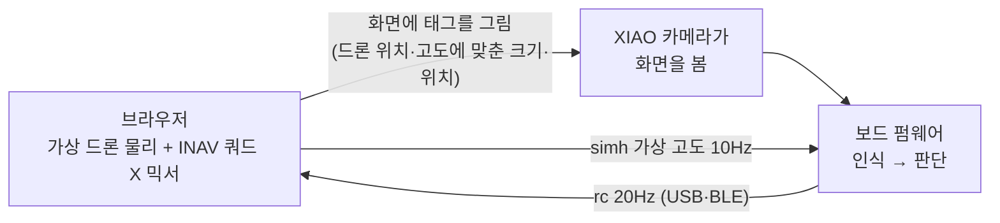

# 10. 도구·시뮬레이터

## 모니터 (`tools/tag_monitor.py`)

보드의 JSON 출력을 한글로 풀어 보여준다. USB와 블루투스를 모두 지원한다.

```bash
python3 tools/tag_monitor.py                        # USB 실시간 해석
python3 tools/tag_monitor.py --snap view.jpg        # 카메라 화면 저장
python3 tools/tag_monitor.py --cmd "tags"           # 명령 보내고 계속 보기
python3 tools/tag_monitor.py --raw                  # JSON 원문
uv run --with bleak --with pyserial python3 tools/tag_monitor.py --ble   # 블루투스
```

- 표시 항목: `[판단]`(목표 태그, 이동, 다음 단계), `[MTF-01P]`, `[MSP→FC]`(보낸 값과 FC가 쓰는 값), `[카메라]`, `[마이크]`, `[음성 명령]`
- 스냅샷은 줄 사이에 끼어든 JSON을 걸러내고, base64 길이가 예상과 다르면 경고한다.
- USB 포트를 열면 보드가 재부팅될 수 있다. 블루투스는 재부팅하지 않는다.

- `fc`·`kill`·`fcmsp`·`gimbal` 메시지는 아직 한글로 풀어 주지 않고 JSON 원문으로 보인다.

## FC 직접 점검 (2026-10-10)

FC USB(VCP, macOS `/dev/cu.usbmodem3466324A35331`, "STM32 Virtual ComPort in FS Mode")나 보드를 거쳐 FC를 점검했다. 이때 쓴 스크립트는 임시 작업 폴더에 있고 저장소에는 아직 넣지 않았다.

| 방법 | 쓰는 곳 | 주의 |
|---|---|---|
| FC USB **CLI** (`status`, `aux`, `get`, `set`, `save`) | 설정 읽기·변경 | CLI에 들어가면 재부팅 전까지 아밍이 막힌다. 끝나면 반드시 `save` 또는 `exit` |
| FC USB **MSP** | 설정 확인(`MSP_MODE_RANGES` 34, `MSP2_COMMON_SETTING` 0x1003), 아밍 플래그(`MSP2_INAV_STATUS` 0x2000), 채널 값(`MSP_RC` 105) | 아밍에 영향 없음. 확인은 이 방법으로 |
| 보드 `fcmsp <명령> [hex]` | FC USB 없이 블루투스로 질의·설정 | 예: `fcmsp 151`(센서 상태), `fcmsp 58`(거리센서 높이), `fcmsp 0x1003 <설정이름 hex + 00>` |
| 킬 시험 (안내형) | 보드에 `kill`을 보내고 FC 상태를 계속 읽어 디스아밍까지의 과정을 기록 | ch6 보드 조종 → ARM 스위치 → 3초 뒤 자동 `kill` → `kill off` → ARM 스위치 내림 순서. 결과는 [07](07-fc-msp-integration.md) |

- 설정 이름을 hex로 바꾸는 예: `python3 -c "print(b'motorstop_on_low\0'.hex())"`
- FC 설정을 바꾸기 전에는 `diff all`을 `fc-info/`에 백업한다.

## 카메라 창 (`tools/cam_view.py`)

보드의 `snap`을 반복 호출해 실시간(1~2fps) 영상을 띄우고, 인식된 태그·광류를 겹쳐 보여 준다. 10-10 밤에 아래를 추가했다.

| 옵션·표시 | 내용 |
|---|---|
| `--init "명령1;명령2"` | 보드가 켜진 뒤(포트를 열면 재부팅됨) 명령을 자동으로 보낸다. 예: `approach bench;approach set vel_kp 6;approach set tag_stale_ms 1500` |
| `--ap-log 파일` | `approach` 보고와 그 시점 FC 채널 값(`fc_rc`)을 JSON 줄로 기록 |
| 화면 오른쪽 위 | **INAV 롤·피치**(FC가 실제로 쓰는 값 = Configurator Receiver 탭 값). 1500에서 벗어나면 초록색. CH6·AUTO/MANUAL |
| 화면 왼쪽 | 접근 상태·사유, 목표 속도, 상대 속도, **보드 명령(µs)**·기울기(°)·expo, 태그 크기(자동/설정·표본 수) |
| **이유 줄** (10-10 밤 2차) | 초록 "INAV 명령 중 · 태그 Ncm 떨어짐 → 목표 속도" / 주황 "INAV 1500 · 이유"(높이 범위 밖, 태그 속도 없음, 정지 반경 5cm 안, 도착 등). 조건 표: [비행 준비 보고서](2026-10-10-tilt-output-tagcal-flight-prep.md) 4.3절 |
| `--ble` | USB 대신 블루투스. 사진 한 장 약 10초(그동안 상태 줄도 멈춤), 오버레이는 0.25초마다 마지막 사진 위에 다시 그림, `p` 키로 사진 바로 요청. USB가 멈췄을 때만 쓴다 |
| `--snap-period 초` | 사진 사이 쉬는 시간. 0.5면 화면 약 2~3장/s, 태그 인식 약 4~5회/s |
| INAV 값 출처 | `-34`부터 `approach` 줄의 `fc_rp`(5Hz). 그 전 펌웨어는 `msp` 줄(1Hz) |

- Mac 실행: 프로젝트 가상환경의 Tk가 깨져 있어 uv Python 3.12로, Tcl 경로를 지정해 실행한다. 글꼴은 Windows 맑은 고딕 → macOS Apple SD 고딕 Neo 순으로 찾는다.
  ```bash
  B=~/.local/share/uv/python/cpython-3.12.10-macos-aarch64-none/lib
  cd /tmp && TCL_LIBRARY=$B/tcl8.6 TK_LIBRARY=$B/tk8.6 uv run --no-project --python 3.12 --with pyserial --with pillow \
    python3 <D4D>/tools/cam_view.py --port /dev/cu.usbmodem1101 --init "approach bench" --ap-log ap.jsonl
  ```
- 창이 사진을 계속 받는 동안 태그 인식이 느려진다(쉬는 시간 없이 약 1.5회/s, `--snap-period 0.5`에서 약 4~5회/s). 비행 기록에는 쓰지 않는다 — 비행은 `tag_monitor.py --ble --raw > 기록.jsonl`.
- `--ap-log`에는 `approach`·`vision`·이벤트와 `tag` 줄(크기 보정 분석용)이 남는다. 보드가 재부팅되면 `--init` 명령을 다시 보낸다.
- 같은 포트를 쓰므로 모니터·다른 기록 도구와 동시에 열 수 없다.
- `tag_monitor.py`에도 `approach` 한 줄 표시를 추가했다: 태그 위치 → 목표 속도 → 상대 속도 → 보드 명령 → 보낸 값 → **FC 롤·피치**.

## 마이크 도구 (`tools/voice_tool.py`)

[09](09-voice-mic.md)를 참고한다. `level`, `rec`, `collect`, `cmd` 기능이 있다.

## 브라우저 시뮬레이터 (`sim/index.html`)

드론 없이 **실제 보드의 카메라와 펌웨어**로 미션 전체를 시험한다(하드웨어 인 더 루프).



**실행**
```bash
python3 -m http.server 8000 -d sim    # Chrome에서 http://localhost:8000
```
1. **USB 연결** 또는 **블루투스 연결**을 누른다. 목록에는 Espressif 장치 또는 `TagBoard`만 나와 FC에 잘못 연결되지 않는다.
2. **카메라 화면 보기**로 카메라가 왼쪽 흰 영역을 보는지 확인한다. 거리는 25~35cm, 화면 밝기는 최대로 둔다.
3. **자동 보정**을 누른다. 태그를 세 곳에 그려 카메라의 회전·반전·중심 어긋남을 구한다.
4. **리셋 → 시작**을 누른다.

**시험 가능한 상황:** 바람·돌풍, 태그 가리기(놓침), 보드 MSP 끊기(INAV 복귀), 조종권 전환, ANGLE/POSHOLD 모드, 태그 크기(저고도 이탈)

**모델 가정**
- 이 FC 설정값을 반영했다: `nav_manual_speed` 750cm/s, 최대 기울기 45°, 호버 1300, 데드밴드 ±10µs
- POSHOLD에서는 FC가 바람의 85%를 상쇄한다고 가정했다.
- 이 FC는 실제로는 POSHOLD를 쓸 수 없다([07](07-fc-msp-integration.md)).

**검증 기록 (헤드리스 Chrome)**
- 화면 태그를 AprilTag 검출기로 확인했다. ID 10으로 인식됐고, 위치 오차는 0.3px 이하, 화면에서 잰 오프셋은 실제와 일치했다.
- 보드 대신 같은 제어식을 쓰는 가짜 보드로 폐루프를 돌렸다(지연 0.3초, 옆바람 20cm/s). 미션 전 단계를 13초에 완료했지만, 처음 정렬에서 약 15cm를 지나쳤다.
- **실제 보드로는 아직 실행하지 않았다.**

## PC 테스트 (`tag-board-fw/test/`)

| 테스트 | 확인 내용 | 결과 |
|---|---|---|
| `msp_host_test.cpp` + `check_msp.py` | MSP 프레임 생성(헤더·체크섬·채널·리틀엔디언)을 규격대로 독립 해석, 응답 파서(잡음·체크섬 오류·FC 거부). 10-10: MSP v2 요청 CRC, 실제 MTF v2 프레임, v1·v2 섞인 흐름 추가 | 통과 |
| `mtf_host_test.cpp` | 보드가 실제로 받은 MSP 모드 바이트로 MTF 파서, 플로우 단위 변환, Micolink 프레임 | 통과 (1709mm 해석) |
| `adpcm_host_test.cpp` + `check_adpcm.py` | 보드 ADPCM 인코더 → Python 해독기 왕복 | SNR 32.2dB, 통과 |
| `approach_host_test.cpp` | 접근 제어기: 프로파일·가속 제한·제동·도착·고장, 지상 시험 모드, INAV 곡선 왕복, 기울기 출력, 지연이 있는 1차원 기체 모델(`-30`) | 최대 10.83cm/s, 지나침 0, 통과 |
| `tag_size_cal_host_test.cpp` (`-33`/`-34`) | 크기 표본 계산, 수렴·튀는 값·오래된 표본, 마지막 수렴값 유지 | 통과 |
| `gimbal_host_test.cpp` (`-21`, 작성 예정) | 팬·틸트 광선 회전, 지면 교점, 바로 아래일 때 기존 식과 같은지, 펄스 범위 자르기 | — |

```bash
cd tag-board-fw
clang++ -std=c++17 -I src test/msp_host_test.cpp -o /tmp/msp_test && /tmp/msp_test | python3 test/check_msp.py
clang++ -std=c++17 -I src test/mtf_host_test.cpp -o /tmp/mtf_test && /tmp/mtf_test
clang++ -std=c++17 -I src test/adpcm_host_test.cpp -o /tmp/adpcm_test && /tmp/adpcm_test | python3 test/check_adpcm.py
clang++ -std=c++17 -I src test/approach_host_test.cpp -o /tmp/ap_test && /tmp/ap_test
clang++ -std=c++17 -I src test/tag_size_cal_host_test.cpp -o /tmp/tagcal_test && /tmp/tagcal_test
```
